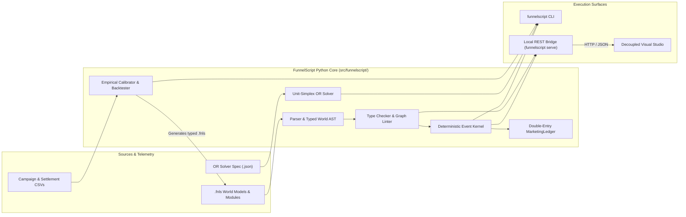

<p align="center">
  <picture>
    <source media="(prefers-color-scheme: dark)" srcset="assets/brand/funnelscript-wordmark-dark.svg">
    <source media="(prefers-color-scheme: light)" srcset="assets/brand/funnelscript-wordmark-light.svg">
    
  </picture>
</p>

<h2 align="center">Simulate Before You Spend.</h2>

<p align="center">
  A declarative programming language, deterministic discrete-event runtime, and Operations Research solver<br>
  for <strong>Marketing Systems Engineering</strong> — with audited double-entry accounting and empirical parameter calibration.
</p>

<p align="center">
  <a href="https://github.com/funnelscript/funnelscript/actions/workflows/preview-ci.yml"></a>
  <a href="https://www.python.org/"></a>
  
  
  <a href="LICENSE"></a>
</p>

<p align="center">
  <a href="#why-funnelscript">Why</a> ·
  <a href="#quick-start-30-seconds">Quick Start</a> ·
  <a href="#empirical-benchmark">Benchmark</a> ·
  <a href="#flagship-stress-tests">Stress Tests</a> ·
  <a href="#or-allocation-solver">OR Solver</a> ·
  <a href="#the-world-language">Language</a> ·
  <a href="#cli-reference">CLI</a> ·
  <a href="#architecture">Architecture</a> ·
  <a href="#installation">Install</a> ·
  <a href="#ecosystem--docs">Docs</a>
</p>

---

<p align="center">
  <a href="assets/video/FunnelScript-Promo-v3.mp4">
    
  </a>
</p>
<p align="center">
  <sub><a href="assets/video/FunnelScript-Promo-v3.mp4">▶ Watch the 47-second Promo Film (1080p MP4)</a></sub>
</p>

---

## Why FunnelScript?

Growth plans fail in production because static spreadsheets assume **linear CAC**, **instant cash settlement**, and **infinite operational capacity**. FunnelScript replaces unverified spreadsheets and hand-drawn funnels with executable, type-checked `.fnls` **World models** — where every dollar is tracked, every bottleneck is simulated, and every allocation decision is mathematically optimal.

| Failure Mode | Static Spreadsheet | FunnelScript |
| :--- | :--- | :--- |
| **Scaling Saturation** | Assumes constant CAC when spend doubles | Fits empirical Hill saturation curves ($V_{\max}, K_{\text{sat}}, \alpha$) with adstock carryover |
| **Liquidity & Cash Lag** | Treats booked revenue as immediate cash | Models settlement latency ($\Delta_{\text{settle}}$), COD lag, rolling reserves, and RTO drag |
| **Sales Bottlenecks** | Ignores human rep throughput | Simulates lead queues, speed-to-lead SLA collapse, and exponential lead cooling |
| **Financial Provenance** | Unaudited floating-point cell formulas | Exact `Decimal` double-entry `MarketingLedger` — zero `$0.00` float drift |
| **Budget Allocation** | Manual gut-feel channel splits | Convex unit-simplex OR solver with equalized shadow prices ($\lambda$) and SHA-256 artifact provenance |

---

## Quick Start (30 seconds)

**Prerequisites:** Python 3.12+, [`uv`](https://github.com/astral-sh/uv)

```bash
git clone https://github.com/funnelscript/funnelscript.git
cd funnelscript
uv sync

# Scaffold and type-check your first World model
uv run funnelscript init-world first.fnls
uv run funnelscript check first.fnls

# Run with a typed event payload (deterministic — seed 1 always gives the same result)
uv run funnelscript run-world first.fnls \
  --event '{"name":"Prospect.Impression","time":0,"payload":{"cpc":2.0,"conversion_probability":0.7,"order_value":100.0}}' \
  --seed 1
```

Or install directly from the `v0.2.0a1` preview tag — no clone required:

```bash
uvx --from "git+https://github.com/funnelscript/funnelscript@v0.2.0a1" funnelscript init-world first.fnls
uvx --from "git+https://github.com/funnelscript/funnelscript@v0.2.0a1" funnelscript check first.fnls
```

---

## Empirical Benchmark

An e-commerce brand runs ~\$2,200/day across Meta Ads + Google Search (Weeks 1–2), then doubles to ~\$6,500/day (Weeks 3–4). Every command below runs against **bundled repository telemetry** — reproducible by anyone.

### Step 1 — Calibrate from Historical Data

```bash
uv run funnelscript calibrate examples/data/ecommerce_campaign_30d.csv \
  --settlements examples/data/payment_settlement_logs.csv \
  --output examples/calibrated_ecommerce_2026.fnls
```

```
           Empirical Calibration Report: CalibratedEcommerceWorld
┏━━━━━━━━━━━━━━━┳━━━━━━━━━━━━┳━━━━━━━━━━━━┳━━━━━━━┳━━━━━━━━┳━━━━━━━━━━━━━━━┓
┃ Channel       ┃  V_max ($) ┃  K_sat ($) ┃ Alpha ┃ Fit R² ┃ Empirical CAC ┃
┡━━━━━━━━━━━━━━━╇━━━━━━━━━━━━╇━━━━━━━━━━━━╇━━━━━━━╇━━━━━━━━╇━━━━━━━━━━━━━━━┩
│ google_search │  $8,310.05 │  $1,128.42 │ 1.500 │  0.953 │        $48.28 │
│ meta_ads      │ $22,966.89 │ $19,460.85 │ 0.603 │  0.927 │        $62.16 │
└───────────────┴────────────┴────────────┴───────┴────────┴───────────────┘
Blended CAC: $54.98  |  AOV: $125.85  |  Δ_settle: 3 days
Dataset Fingerprint: sha256:8e7b134808c035c1
```

### Step 2 — Type-Check the Generated Model

`calibrate` compiles fitted non-linear parameters directly into a typed `.fnls` World:

```funnelscript
world CalibratedEcommerceWorld {
  entity CampaignContext {
    state total_budget:         float = 132388.61;
    state initial_cash:         float = 52955.44;
    state settlement_delay_days: int  = 3;
    state gateway_fee_rate:     float = 0.0290;
    state blended_cac:          float = 54.98;
    state average_order_value:  float = 125.85;
  }

  entity GoogleSearch {
    state v_max: float = 8310.05;
    state k_sat: float = 1128.42;
    state alpha: float = 1.500;
  }

  entity MetaAds {
    state v_max: float = 22966.89;
    state k_sat: float = 19460.85;
    state alpha: float = 0.603;
  }

  agent CustomerAcquisition {
    state conversions: int = 0;
    event AdClick(cpc: float);
    rule OnClick on event AdClick {
      transition conversions = conversions + 1;
    }
  }
}
```

```bash
uv run funnelscript check examples/calibrated_ecommerce_2026.fnls
```

### Step 3 — 50/50 Temporal Holdout Backtest

Weeks 3–4 holdout: `$99,524.91` total spend, `$15,000` starting cash:

```bash
uv run funnelscript backtest examples/data/ecommerce_campaign_30d.csv \
  --settlements examples/data/payment_settlement_logs.csv \
  --cash 15000
```

| Metric | Ground Truth | FunnelScript MAPE | Spreadsheet MAPE | Advantage |
| :--- | :---: | :---: | :---: | :---: |
| **Revenue** | `$12,869.61` | **37.06%** | 72.89% | **1.97x** |
| **Conversions** | `102.0` | **36.60%** | 74.16% | **2.03x** |
| **Cash Ruin Event** | **Day 3** | **Day 3 ✓** | NEVER (False Safe ✗) | **Detected** |

> Because payment settlement takes 3 days ($\Delta_{\text{settle}} = 3$), ramping to ~\$6,500/day drains the `$15,000` cash reserve before inflows land. The spreadsheet reports **NEVER**. FunnelScript flags cash ruin on **Day 3**.

---

## Flagship Stress Tests

FunnelScript ships two domain stress-test packages under `packages/` that reconcile every dollar through the double-entry `MarketingLedger` with zero float drift.

### 1 · D2C Working Capital Insolvency

Models a scaling D2C brand with strong nominal ROAS that still breaches cash runway due to immediate ad spend, 7-day COD remittance lag, rolling gateway reserves, and Return-to-Origin (RTO) round-trip shipping loss.

```bash
uv run main.py simulate examples/d2c_scale_stress.fnls
```

| Metric | Verified Result |
| :--- | :--- |
| **Paper ROAS** | `5.43x` |
| **Realized Net Margin** | `3.18x` |
| **Starting Cash** | `$75,000.00` |
| **Min Cash Trough** | **Day 12 (`-$17,953.41`)** |
| **Cash Runway Status** | **BREACHED on Day 8** |
| **Ledger Audit** | `✓ PASSED — Exact Double-Entry, Zero Float Drift` |

### 2 · High-Ticket Sales Capacity Collapse

Models scaling ad spend into a fixed 4-rep sales team (`12 leads/rep/day`). Queue backlog drags speed-to-lead from 15 minutes to 41+ hours, triggering exponential lead cooling and destroying unit economics while ad-platform CPL stays flat.

```bash
uv run main.py simulate examples/sales_capacity_stress.fnls
```

| Metric | Verified Result |
| :--- | :--- |
| **Blended CPL** | `$77.88` |
| **Peak Queue Backlog** | `486 leads` |
| **Avg Speed-to-Lead** | `2,513.7 minutes` (↑ from 15 min) |
| **Capacity Utilization** | `100.0%` |
| **Effective Close Rate** | `0.05%` |
| **Effective CAC** | **`$165,999.90`** |
| **Ledger Audit** | `✓ PASSED — Exact Double-Entry, Zero Float Drift` |

---

## OR Allocation Solver

`funnelscript solve` optimizes multi-channel spend over a normalized unit simplex ($w \in [0, 1]^n,\ \sum w_i = 1$) with scale-invariant finite-difference gradients, empirical spend-support classification, lineage checks, and **SHA-256 artifact provenance** on every output.

```bash
uv run funnelscript solve examples/sample_solver_spec.json
```

```
               Optimal Marketing Decision Allocation (OR Solver)
┏━━━━━━━━━━━━━━━┳━━━━━━━━━━━━━━━┳━━━━━━━━━━━━━━━┳━━━━━━━━━━━━━━━┳━━━━━━━━━━━━━━┓
┃ Channel       ┃ Optimal Spend ┃ Simplex Weight┃ Shadow Price  ┃ Support      ┃
┃               ┃           ($) ┃           (w) ┃           (λ) ┃ Status       ┃
┡━━━━━━━━━━━━━━━╇━━━━━━━━━━━━━━━╇━━━━━━━━━━━━━━━╇━━━━━━━━━━━━━━━╇━━━━━━━━━━━━━━┩
│ meta_ads      │    $18,251.07 │        0.3650 │        1.3367 │ EMPIRICAL    │
│ google_search │    $22,763.12 │        0.4553 │        1.3367 │ EMPIRICAL    │
│ tiktok_ads    │     $8,985.82 │        0.1797 │        1.3367 │ EMPIRICAL    │
└───────────────┴───────────────┴───────────────┴───────────────┴──────────────┘
Total Budget: $50,000.00 USD
Expected Revenue: $134,575.41  |  Net Profit: $84,575.41  |  Blended CAC: $37.15
Artifact Checksum (SHA-256): 4b70aa12c67ecd562bb10f8caf0026957f7589395b981ca8b6b5779cb3913408
```

Equalized shadow prices ($\lambda_i = \lambda_j$ for all active channels) confirm the solver reached the **Pareto-optimal frontier**: no unilateral budget shift can increase expected revenue without violating the constraint.

---

## The `world` Language

At its core, FunnelScript is a **domain-neutral, statically typed discrete-event language**. Marketing modules (such as `std:marketing/lead_response.fnls`) are ordinary `.fnls` source files, not hardcoded compiler keywords. The kernel enforces a strict separation: the language is universal; the domain is a library.

### EBNF Grammar (excerpt)

```ebnf
WorldFile        ::= "world" Identifier "{" WorldDeclaration* "}" ;
WorldDeclaration ::= ("entity" | "agent") Identifier "{" WorldMember* "}"
                   | "import" StringLiteral ("as" Identifier | "{" NamedImport* "}") ";" ;
WorldMember      ::= StateField | EventDeclaration | RuleDeclaration ;
StateField       ::= "state" Identifier ":" PrimitiveType "=" StateLiteral ";" ;
EventDeclaration ::= "event" Identifier "(" EventFieldList? ")" ";" ;
RuleDeclaration  ::= "rule" Identifier "on" "event" Identifier GuardClause? "{" RuleStatement* "}" ;
GuardClause      ::= "when" "(" Identifier GuardOp StateLiteral ")" ;
RuleStatement    ::= TransitionStatement | EmitStatement ;
SampleExpression ::= "sample" ("bernoulli" "(" SampleArgument ")"
                   | "uniform" "(" SampleArgument "," SampleArgument ")") ;
```

### Language Primitives

| Feature | Description |
| :--- | :--- |
| **Typed Declarations** | `world`, `entity`, `agent` with strict `int` / `float` / `bool` / `string` state fields |
| **Typed Event Payloads** | `event Click(cpc: float);` — validated before handler execution, missing/extra fields fail explicitly |
| **Guarded Transitions** | `when (guard)` predicates; false guard consumes event but suppresses all transitions and emissions |
| **Causal Scheduling** | `emit NextEvent(field = expr) after Delay;` — same-owner, forward-reference valid |
| **Seeded Stochasticity** | `sample bernoulli(p)` and `sample uniform(a, b)` on a deterministic PRNG stream |
| **Composable Modules** | Named multi-export imports and `fpm`-resolved external packages |
| **Event Playbooks** | Strict UTF-8 `funnelscript-event-playbook-v1` JSON (capped at 1 MiB / 10,000 events) |

### A Real World in Action

```funnelscript
world HolidayExperiment {
  import "std:marketing/lead_response.fnls" as Prospect;

  entity Budget {
    state daily_cap:   float = 5000.00;
    state spent_today: float = 0.00;

    event DayReset();
    rule OnReset on event DayReset {
      transition spent_today = 0.00;
    }
  }

  agent CustomerAcquisition {
    state conversions: int   = 0;
    state total_value: float = 0.00;

    event Impression(cpc: float, conversion_probability: float, order_value: float);

    rule OnImpression on event Impression when (conversions < 1000) {
      transition conversions = conversions + sample bernoulli(payload.conversion_probability);
      transition total_value = total_value + payload.order_value;
      emit Impression(cpc = payload.cpc,
                      conversion_probability = payload.conversion_probability,
                      order_value = payload.order_value) after 1;
    }
  }
}
```

```bash
# Type-check: catches undefined states, payload mismatches, and guard type errors at zero runtime cost
uv run funnelscript check examples/marketing_lead_response.fnls

# Single typed event — seed 1 always produces identical output
uv run funnelscript run-world examples/marketing_lead_response.fnls \
  --event '{"name":"Prospect.Impression","time":0,"payload":{"cpc":2.0,"conversion_probability":0.7,"order_value":100.0}}' \
  --seed 1

# Multi-export module + versioned event playbook
uv run funnelscript run-world examples/phase007g_world.fnls \
  --events-file examples/phase007g_events.json \
  --seed 42
```

<details>
<summary><strong>Python <code>EventMachine</code> API</strong></summary>

```python
from funnelscript.core import Event, EventMachine, Transition

def step(count, event, rng):
    return Transition(state=count + 1)

result = EventMachine(step).run(
    0, (Event(0.0, "first"), Event(2.0, "second")), seed=42
)
assert result.state == 2
```

</details>

<details>
<summary><strong>Legacy Monte Carlo Simulator (P10 / P50 / P90, VaR-95, CVaR-95)</strong></summary>

```bash
uv run funnelscript check   examples/black_friday_2026.json
uv run funnelscript simulate examples/black_friday_2026.json --trials 100 --agents 50000
```

</details>

---

## Architecture

FunnelScript enforces a **Single Source of Truth** runtime: parsing, type-checking, discrete-event simulation, double-entry accounting, and convex optimization live exclusively in Python (`src/funnelscript/`). External UIs connect over the local HTTP bridge with zero duplicated math.



### Module Map

| Path | Responsibility |
| :--- | :--- |
| [`src/funnelscript/parser.py`](src/funnelscript/parser.py) + [`tokens.py`](src/funnelscript/tokens.py) | Source parsing and token definitions |
| [`src/funnelscript/compiler/world_ast.py`](src/funnelscript/compiler/world_ast.py) | Typed World AST, semantic validation, module contracts |
| [`src/funnelscript/core/event_machine.py`](src/funnelscript/core/event_machine.py) | Discrete-event ordering, bounded execution, seeded RNG |
| [`src/funnelscript/runtime/world_executor.py`](src/funnelscript/runtime/world_executor.py) | Pure World rule execution and events |
| [`src/funnelscript/runtime/simulator.py`](src/funnelscript/runtime/simulator.py) | Legacy marketing Monte Carlo simulator |
| [`src/funnelscript/solver/optimizer.py`](src/funnelscript/solver/optimizer.py) | Convex unit-simplex OR solver + shadow prices |
| [`src/funnelscript/stdlib/marketing/__init__.py`](src/funnelscript/stdlib/marketing/__init__.py) | Marketing Standard Library: calibration, backtest, ingestion, kernels |
| [`src/funnelscript/cli.py`](src/funnelscript/cli.py) | Full CLI surface: `check`, `run-world`, `calibrate`, `backtest`, `solve`, `serve`, `simulate` |
| [`packages/ecommerce/d2c_scale/`](packages/ecommerce/d2c_scale/README.md) | Stress-test domain packages: `ecommerce/d2c_scale`, `leadgen/sales_capacity` |

---

## Installation

FunnelScript requires **Python 3.12+** and is managed with [`uv`](https://github.com/astral-sh/uv).

### From Source (Recommended)

```bash
git clone https://github.com/funnelscript/funnelscript.git
cd funnelscript
uv sync
uv run funnelscript --version
```

### Zero-Checkout Preview (`v0.2.0a1`)

```bash
# Scaffold
uvx --from "git+https://github.com/funnelscript/funnelscript@v0.2.0a1" funnelscript init-world first.fnls

# Type-check
uvx --from "git+https://github.com/funnelscript/funnelscript@v0.2.0a1" funnelscript check first.fnls

# Run with a typed event (deterministic replay)
uvx --from "git+https://github.com/funnelscript/funnelscript@v0.2.0a1" funnelscript run-world first.fnls \
  --event '{"name":"Prospect.Impression","time":0,"payload":{"cpc":2.0,"conversion_probability":0.7,"order_value":100.0}}' \
  --seed 1
```

> **Note:** `v0.2.0a1` is an experimental research preview — not yet published to PyPI. No production guarantees; no causal market validity; no live execution engine.

---

## CLI Reference

| Command | Purpose |
| :--- | :--- |
| `funnelscript check <file>` | Parse and statically verify `.fnls` World types (`compile` is an alias) |
| `funnelscript run-world <file>` | Execute deterministic World rules with `--event`, `--events-file`, `--seed`, `--max-events` |
| `funnelscript calibrate <csv>` | Infer Hill saturation parameters & settlement latency → emit typed `.fnls` World |
| `funnelscript backtest <csv>` | Run 50/50 temporal holdout benchmark vs. linear spreadsheet baseline |
| `funnelscript solve <spec.json>` | Optimize multi-channel budget over the unit simplex with shadow prices & SHA-256 provenance |
| `funnelscript simulate <file>` | Stochastic Monte Carlo or stress-test simulations (`--json`, `--export-csv`, `--export-json`) |
| `funnelscript serve` | Start local HTTP API bridge on `127.0.0.1:8000` (`/api/health`, `/api/check`, `/api/simulate`) |
| `funnelscript init-world <file.fnls>` | Scaffold a minimal runnable `.fnls` World importing `std:marketing/lead_response.fnls` |
| `funnelscript init <name>` | Scaffold a legacy JSON strategy template |
| `funnelscript schema` | Print or export the Draft 2020-12 JSON Schema |

See [docs/CLI_REFERENCE.md](docs/CLI_REFERENCE.md) for all flags and exit codes.

---

## Testing & Verification

```bash
uv run pytest -v
# 800 passed, 58 subtests — in ~25s
```

The test suite covers:
- **World parser & AST** — positive and negative-path grammar tests
- **Type checker** — payload mismatch, guard type errors, undeclared state
- **Event kernel** — deterministic replay, seeded stochasticity, causal scheduling
- **Calibration & backtest** — Hill fitting, settlement lag, holdout accuracy
- **OR solver** — simplex convergence, shadow price equalization, SHA-256 provenance
- **Brand identity** — SVG validity, WCAG AA contrast, font-file independence
- **Documentation links** — all relative `README.md` and `docs/` paths resolve to real files

### Scientific Boundaries

- FunnelScript executes **in-memory deterministic and seeded stochastic simulations**. It never mutates live ad accounts, payment gateways, or external APIs.
- Calibration and backtest accuracy depend on the quality and regime coverage of supplied historical telemetry. Uncalibrated World models reflect author-supplied assumptions, not empirical market forecasts.
- This is an **experimental research preview**. Production and predictive-validity readiness are not implied by the readiness rubric score.

---

## Ecosystem & Docs

### Sister Repositories

| Repository | Purpose |
| :--- | :--- |
| [`funnelscript/funnelscript-research`](https://github.com/funnelscript/funnelscript-research) | Formal proofs, SciML marketing hydrodynamics, holdout falsification protocols |
| [`funnelscript/funnelscript-studio`](https://github.com/funnelscript/funnelscript-studio) | Decoupled React 19 + TypeScript visual canvas (standalone prototype) |

### Documentation

| Guide | Description |
| :--- | :--- |
| [Experimental Preview Guide](docs/EXPERIMENTAL_PREVIEW.md) | First World, local modules, failure boundaries |
| [World Rules Language Reference](docs/LANGUAGE_REFERENCE_WORLD_RULES.md) | EBNF grammar, guards, typed payloads, scheduling |
| [CLI Reference Manual](docs/CLI_REFERENCE.md) | Full command flags and exit code specification |
| [Package Manager Spec (`fpm`)](docs/fpm.md) | Manifests, lockfiles, reusable marketing packages |
| [Marketing Systems Engineering](docs/MARKETING_SYSTEMS_ENGINEERING.md) | Manifesto and core mental models |
| [The Shim Strategy](docs/SHIM_STRATEGY.md) | Specification-first adoption and the linter wedge |
| [Architecture Decisions](docs/DECISIONS.md) | Engineering decision records |
| [Engineering Debates](docs/DEBATES.md) | Open design questions and trade-offs |
| [Anti-Patterns](docs/ANTI_PATTERNS.md) | Known pitfalls and how to avoid them |
| [Open-Source Growth Playbook](docs/OPEN_SOURCE_GROWTH_PLAYBOOK.md) | Community strategy and ecosystem vision |
| [Contributing Guide](CONTRIBUTING.md) | Implementation map, TDD contract, contribution scope |

---

## Contributing

FunnelScript is research-first and TDD-driven. Before changing language behavior: read [`AGENTS.md`](AGENTS.md), record a falsifiable hypothesis and explicit invariants, write a RED test, then implement the minimum GREEN change.

```bash
git clone https://github.com/funnelscript/funnelscript.git
cd funnelscript
uv sync --locked --dev
uv run pytest -v     # all 800 tests must pass before submitting
uv build
```

See [CONTRIBUTING.md](CONTRIBUTING.md) for the full implementation map, research-TDD contract, and contribution scope rules.

---

## License

MIT License — see [LICENSE](LICENSE).
