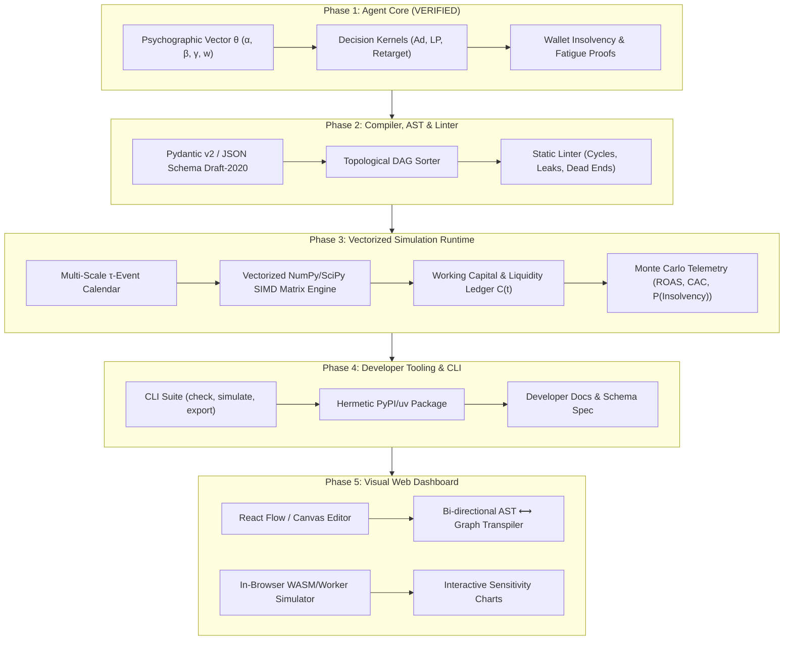

# FunnelScript Master Execution Plan (Phases 2 – 5)

**Governing Constitution:** [`AGENTS.md`](../AGENTS.md) (Hypothesis-First & Research-Gated Engineering)
**Methodology:** Core-Outwards & Discrete-Event Systems Engineering  
**Status:** Historical phased design blueprint, **not** a released version or a statement that every pictured subsystem exists. The verified public source preview is `v0.2.0a1`; see [Public Preview Readiness](PUBLIC_PREVIEW_READINESS.md).

---

## Executive Summary & Baseline State

The FunnelScript ecosystem elevates marketing tactics from ambiguous slide decks into mathematically verifiable, executable discrete-event state machines. 

### Phase 1 Baseline (Complete & Verified):
* **Module:** `funnelscript.core.agent`
* **Artifacts:** Vectorized & discrete consumer agent representation ($\theta = \langle \alpha, \beta, \gamma, w \rangle$), stochastic micro-decision formulas ($P_{\text{click}}, P_{\text{purchase}}, P_{\text{recovery}}$), wallet insolvency boundary checks, ad fatigue decay models.
* **Verification:** 10/10 automated tests passing (`tests/test_agent_core.py`, `tests/test_funnelscript.py`), interactive 10-agent profiling sandbox (`examples/demo_agent_mind.py`).
* **Repositories:** Active, synced, and versioned at [`funnelscript/funnelscript`](https://github.com/funnelscript/funnelscript) and [`funnelscript/funnelscript-research`](https://github.com/funnelscript/funnelscript-research).

---

## The Master Architecture Flow

---

## Phase 2: The AST, JSON Schema & Static Semantic Linter

### 1. Scope & Objective
Formalize the campaign specification into an immutable, type-safe Abstract Syntax Tree (AST), complete the EBNF grammar compiler, and build a deterministic static linter that catches reachability defects, attribution cycles, and audience leaks before execution.

### 2. Research Anchor & Prior Art
* **Graph Theory & Compilers:** Aho, Lam, Sethi, Ullman (*Compilers: Principles, Techniques, & Tools*). Topological sorting (Kahn's algorithm) and Tarjan's strongly connected components (SCC) algorithm for cycle detection in directed flow networks.
* **Declarative Schemas:** JSON Schema Draft 2020-12 / IETF RFC 8259.

### 3. Falsifiable Hypotheses
* **$H_{2.1}$ (Cycle & Dead-End Elimination):** *A graph-theoretic linter running Tarjan's SCC algorithm on the FunnelScript execution DAG detects 100% of non-terminating attribution loops and unreferenced touchpoint sinks in $O(V + E)$ time prior to runtime.*
  * *Falsification Criteria:* Any validly linted campaign that enters an infinite execution loop or hits an undefined node during Phase 3 simulation refutes $H_{2.1}$.
* **$H_{2.2}$ (Economic Boundary Enforcement):** *Schema-level static type verification detects 100% of negative budget allocations, invalid probability ranges ($p \notin [0, 1]$), and undefined audience sources at parse-time.*

### 4. Mathematical & Structural Invariants
1. **DAG Reachability Invariant:** Every declared touchpoint $v \in V_{\text{touchpoints}}$ must be reachable from at least one initial audience node $s_0$:
   $$\forall v \in V, \ \exists \text{ path } p = (s_0, \dots, v)$$
2. **Terminal Absorption Invariant:** Every directed path in the logic graph must terminate in an absorbing state:
   $$\forall p = (v_1, \dots, v_k), \ v_k \in \{\text{CONVERTED}, \text{CHURNED}\}$$
3. **Budget Non-Negativity:**
   $$B_{\text{total}} > 0, \quad \text{CPC}_{\max} > 0, \quad C_0 > 0$$

### 5. Implementation Tasks
* `src/funnelscript/compiler/linter.py`:
  - Build DAG from `StrategyAST.logic_flow`.
  - Implement Kahn's / Tarjan's algorithm for circular dependency detection.
  - Detect dead-end paths (traffic sent to a landing page with no subsequent conversion or churn branch).
  - Detect orphaned audiences (audiences declared in `entities` but never referenced in `flow`).
* `src/funnelscript/compiler/schema.py`:
  - Automated JSONSchema generation (`funnelscript.json-schema`).
* `tests/test_linter.py`:
  - Test suite with 25 corrupted edge-case campaigns (cyclic retargeting, negative budgets, disconnected sinks).

### 6. Contrarian Stress Test (`hate` check)
* *Fatal Flaw:* What if a marketer intentionally wants a recurrent retargeting sequence (e.g. email 1, wait 2 days, email 2, wait 3 days, email 3)? A naive DAG linter would flag this as an "infinite cycle."
* *Mitigation:* Allow bounded recurrence by requiring a monotonic step counter (`max_retries: int <= 5`) on retargeting loops. If no exit condition or step decrement is present, the linter rejects it.

### 7. Definition of Done
* `funnelscript check <file>` successfully lints valid campaigns and rejects all 25 malformed edge cases with clean terminal error diagnostics.
* 100% test coverage on `compiler/linter.py`.

---

## Phase 3: The Vectorized Stochastic Runtime Engine

### 1. Scope & Objective
Scale the discrete agent mechanics from Phase 1 into a high-throughput, vectorized multi-scale event simulation engine capable of running $100,000$ agents across $M = 1,000$ Monte Carlo trials in seconds, calculating full distribution curves for ROAS, CAC, cash runway, and cannibalization.

### 2. Research Anchor & Prior Art
* **Discrete-Event Simulation (DES):** Law & Kelton (*Simulation Modeling and Analysis*); Zeigler (*Theory of Modeling and Simulation*).
* **Vectorized Probability:** SIMD array programming via NumPy 2.x and SciPy stochastic kernels.
* **Computational Economics:** Jay Forrester (*Industrial Dynamics* — MIT Stock & Flow differential equations).

### 3. Falsifiable Hypotheses
* **$H_{3.1}$ (Throughput Scaling):** *Vectorizing agent psychographic evaluations via 2D NumPy array broadcasting processes $\ge 500,000 \text{ agent-days/second}$ on standard commodity CPU hardware, completing $M = 1,000$ trials in $< 15 \text{ seconds}$.*
  * *Falsification Criteria:* Any benchmark runtime exceeding $20\text{ms}$ per 10,000 agent-days refutes $H_{3.1}$.
* **$H_{3.2}$ (Cash Ruin Separation):** *Simulating payment processor settlement delays ($\Delta_{\text{settle}} \in [2, 7]$ days) exposes an emergent Cash Ruin probability $P(\text{Insolvency}) > 0$ that linear expected-value models fail to predict.*

### 4. Mathematical & Structural Invariants
1. **Audience Mass Conservation:**
   $$\sum_{s \in S} N_s(t) = N_{\text{total}}, \quad \forall t \in [0, T]$$
2. **Working Capital Dynamics:**
   $$C(t) = C(t-1) - \text{Spend}(t) + \text{SettledRevenue}(t - \Delta_{\text{settle}})$$
   $$\text{If } C(t) \le 0 \implies \text{HaltAdSpend}(t)$$
3. **Adstock Temporal Decay:**
   $$A_j(t) = \text{Impression}_j(t) + \lambda \cdot A_j(t-1), \quad \lambda \in [0, 1)$$

### 5. Implementation Tasks
* `src/funnelscript/runtime/engine.py`:
  - Multi-scale timeline orchestrator ($t \in [1, T]$ days with sub-daily event resolution).
  - Vectorized audience state tensor: `shape = (N_agents, 4)` for psychographics, `state = (N_agents,)`.
  - Payout settlement delay queue (circular buffer for $t + \Delta_{\text{settle}}$).
* `src/funnelscript/runtime/telemetry.py`:
  - Monte Carlo distribution aggregator: Mean, Median, P10, P90, Value-at-Risk (VaR).
  - Discount cannibalization counter (loyal buyers with $\alpha > 0.75$ using retargeting vouchers).
* `src/funnelscript/runtime/exporters.py`:
  - Export simulation curves to CSV and JSON formats.
* `tests/test_simulation_scale.py`:
  - Performance benchmarks, conservation stress tests, and liquidity halts.

### 6. Contrarian Stress Test (`hate` check)
* *Fatal Flaw:* What if memory consumption blows up when running $10^5$ agents across $1,000$ trials ($10^8$ operations)?
* *Mitigation:* Never store full agent histories across Monte Carlo iterations. Collapse agent states into summary statistical aggregates at the end of each day; retain only scalar trial outcomes in memory.

### 7. Definition of Done
* Successful simulation of $100,000$ agents over 30 days across 1,000 trials in $< 15$ seconds.
* Output of complete probability distributions and liquidity risk metrics.

---

## Phase 4: Developer Tooling, Packaging & CLI Suite

### 1. Scope & Objective
Transform FunnelScript into an ergonomic, production-grade CLI tool and standalone Python package installable via `pip` or `uv tool`, accompanied by comprehensive developer documentation and schema definitions.

### 2. Research Anchor & Prior Art
* **Command-Line Interface Ergonomics:** POSIX IEEE 1003.1 conventions; Twelve-Factor App methodology for config and logs; Rich Terminal formatting standards.
* **Package Distribution:** PEP 517/518/621 build standards using `pyproject.toml` and Hatchling.

### 3. Falsifiable Hypotheses
* **$H_{4.1}$ (Hermetic Execution):** *The packaged FunnelScript CLI executes cleanly in a fresh isolated Python 3.12+ virtual environment with zero missing shared libraries and under $300\text{ms}$ cold startup time.*
* **$H_{4.2}$ (Deterministic Exit Codes):** *CLI commands map 1:1 with standard UNIX exit codes: `0` for verification/simulation pass, `1` for syntax/invariant error, `2` for file I/O failure.*

### 4. Implementation Tasks
* `src/funnelscript/cli.py`:
  - Enhance commands:
    * `funnelscript check <file>`: Strict static type check & lint.
    * `funnelscript simulate <file> [--trials N] [--agents N] [--export-csv path] [--json]`: Run simulation and display rich tables.
    * `funnelscript init <name>`: Generate starter campaign template.
    * `funnelscript schema`: Print or export JSON Schema.
* Packaging:
  - Configure `[project.scripts]` entrypoint: `funnelscript = "funnelscript.cli:main"`.
  - Validate clean wheel build via `uv build`.
* `docs/`:
  - `docs/CLI_REFERENCE.md`: Complete flags and usage manual.
  - `docs/SCHEMA_SPEC.md`: Full entity and block specification.
  - `docs/ANTI_PATTERNS.md`: Catalog of marketing anti-patterns detected by FunnelScript (e.g., The Discount Trap, The Liquidity Mirage, The Retargeting Loop).
* `tests/test_cli.py`: Subprocess execution tests for all CLI flags.

### 5. Definition of Done
* `uv run funnelscript --help` runs seamlessly.
* Successful local build and install test (`uv tool install . --force`).

---

## Phase 5: Visual Web Dashboard (Funnel Canvas & Live Simulation)

### 1. Scope & Objective
Build an interactive visual canvas for marketing practitioners that allows visual drag-and-drop funnel construction, bi-directional code generation (`Visual Graph ⟷ FunnelScript JSON`), and live in-browser Monte Carlo sensitivity analysis.

### 2. Research Anchor & Prior Art
* **Flow-Based Programming:** Morrison (*Flow-Based Programming: A New Approach to Application Development*).
* **Information Visualization:** Edward Tufte (*The Visual Display of Quantitative Information*); Shneiderman's Information Seeking Mantra (*Overview first, zoom and filter, then details-on-demand*).
* **Graph Editors:** React Flow / Svelte Flow component model.

### 3. Falsifiable Hypotheses
* **$H_{5.1}$ (Isomorphic Bi-directionality):** *Any valid visual canvas topology serialized to FunnelScript JSON compiles without error, and any valid FunnelScript JSON renders onto the canvas with zero node overlap or edge inversion ($100\%$ topological isomorphism).*
* **$H_{5.2}$ (Interactive Latency):** *Running local micro-simulations ($10,000$ agents, 14 days) on parameter adjustment (e.g. moving a CPC slider) completes in $< 350\text{ms}$, providing real-time interactive feedback without UI jank.*

### 4. Architectural Stack
* **Framework:** React 19 + TypeScript + Vite.
* **Canvas Engine:** React Flow (@xyflow/react) for draggable nodes (`AudienceNode`, `TrafficNode`, `ConversionNode`, `RetargetingNode`).
* **Styling & UI:** Tailwind CSS, Radix UI primitives, Lucide icons (anti-slop restraint: clean white space, zero marketing clutter).
* **Charting:** Recharts / Chart.js for ROAS probability curves, CAC density plots, and cumulative cash trajectories.
* **Engine Bridge:** Local Python backend API (FastAPI) or WebAssembly (Pyodide) compiling FunnelScript directly in the browser sandbox.

### 5. Implementation Tasks
* `apps/web/`:
  - `components/canvas/`: Custom nodes and edge connections with validation rules (e.g., preventing connecting two audiences directly).
  - `components/telemetry/`: Real-time ROAS distribution histogram, CAC curve, and Cash Runway chart.
  - `components/code-drawer/`: Real-time bi-directional code viewer showing generated FunnelScript JSON.
  - `lib/transpiler.ts`: Graph-to-JSON and JSON-to-Graph serialization engine.
* `tests/e2e/`: Playwright end-to-end tests verifying drag, drop, compile, and simulate workflows.

### 6. Definition of Done
* A user can construct an end-to-end campaign visually, see the generated FunnelScript JSON update live, click "Simulate", and inspect probability curves and cash ruin risk in under 1 second.

---

## Phase-by-Phase Timeline & Milestone Summary

| Phase | Milestone | Deliverable | Primary Metric |
| :--- | :--- | :--- | :--- |
| **Phase 1** | The Agent Core | `funnelscript.core.agent` | 100% test coverage; 10/10 green tests |
| **Phase 2** | Compiler & Linter | `funnelscript.compiler.linter` | Catch 100% of cyclic & dead-end defects |
| **Phase 3** | Vectorized Runtime | `funnelscript.runtime.engine` | $\ge 500\text{k}$ agent-days/sec; P(Insolvency) telemetry |
| **Phase 4** | Developer Tooling | `funnelscript` CLI & PyPI package | Hermetic wheel build; exit-code parity |
| **Phase 5** | Visual Web Dashboard | `apps/web` (React Flow + Charts) | $100\%$ isomorphic serialization; $<350\text{ms}$ sim |

---

## Constitutional Compliance Verification

Every step in this plan complies strictly with [`AGENTS.md`](../AGENTS.md):
- **Rule 1 Enforced:** Every phase specifies its research anchor, falsifiable hypothesis ($H$), and mathematical invariant.
- **Inside-Out Discipline:** Physical UI is strictly fenced into Phase 5, after the mathematical core (P1), linter (P2), runtime (P3), and CLI (P4) are fully verified.
- **Conservation Laws Preserved:** Cash latency ($\Delta_{\text{settle}}$), mass conservation ($\sum N = N_{\text{total}}$), and wallet bounds ($P_{\text{eff}} \le w$) are enforced throughout.

---

## Active Language-Core Milestone: Domain-Neutral Event Semantics (2026-10-31)

**Research gate:** `funnelscript-research/spec/event-kernel-v0.md` documents Zeigler/DEVS, Koka-style handler separation, falsifiable hypotheses H-K1 through H-K4, and the formal event-order/temporal invariants.

**Implementation:** `src/funnelscript/core/event_machine.py` adds a bounded, seeded event calendar, model-owned state transitions, and inert `EffectIntent` values. It intentionally has no audience, campaign, platform, or credential knowledge. Public symbols are exposed through `funnelscript.core`. Existing marketing simulation and compiler behavior are preserved.

**Verification:** `tests/test_event_machine.py` covers event order, stable ties, same-time scheduling, deterministic replay, invalid timestamps, retrograde events, priority inversion, processing bounds, finite horizons, domain neutrality, and unexecuted intents. A passing test suite verifies local semantics only; it does not validate future market predictions.

**Next integration gates (not yet implemented):**
1. Define a neutral `Entity` / `Agent` source-language and AST typing contract, retaining compatibility with the legacy consumer `Agent`.
2. Move `Audience`, `Campaign`, `Touchpoint`, and economic invariants into first-party marketing library surfaces with no compiler-only privilege.
3. Build controlled Simulation and Shadow effect handlers and explicit capabilities; Live execution remains blocked until provider authorization, idempotency persistence, monetary limits, and adversarial security gates are independently tested.
4. Provide optional, versioned empirical calibration adapters for PyMC Marketing and cognitive model adapters for OmniTwin without hard dependencies.

---

## Language Core Milestone: Typed World Declarations (2026-10-31)

**Research gate:** `funnelscript-research/spec/world-declarations-v0.md` records H-W1 through H-W4, prior art on type systems, and explicit uniqueness and literal-typing invariants. The grammar is added as a new `ProgramFile` alternative in `spec/grammar.ebnf`.

**Implementation:** Contextual `world`/`entity`/`agent`/`state` declarations now parse into `WorldAST`, `EntityDefinition`, `AgentDefinition`, and `StateDefinition`. Primitive `int`, `float`, `bool`, `string` initializers are type checked without coercion. Both the CLI `check` branch and an explicit world-simulation rejection path are implemented. The old strategy parser and marketing simulator remain available.

**Verification:** `tests/test_world_language.py` exercises valid AST/subtyping, duplicate and unknown declarations, mismatched literals, malformed syntax, legacy keyword compatibility, CLI typing and simulation rejection. Smoke input: `examples/warehouse_world.fnl`.

**Next gates:** Typed `rule` and `transition` declarations, source-language runtime construction and dispatch to the already tested EventMachine; no autonomous behavior, real-market calibration, or live execution is claimed from typed state declarations alone.

---

## Language Core Milestone: Executable Rules and Transitions (2026-10-31)

**Research gate:** `funnelscript-research/spec/rule-transitions-v0.md` defines H-R1 through H-R4, explicit simultaneous-update semantics, uniqueness/type invariants, and restricted expressions. The formal `spec/grammar.ebnf` now includes `RuleDeclaration` and `TransitionStatement`.

**Implementation:** Typed `EventRuleDefinition`, `StateTransitionDefinition` and expression nodes extend the World AST; the parser accepts contextual `rule R on event E { transition ...; }` blocks. `WorldExecutor` dispatches externally supplied qualified events through the existing `EventMachine`, using copy-on-write and one pre-event snapshot per rule. `run-world` emits a pure JSON state summary. No dynamic `eval`, autonomous event generation, provider interaction or new scheduler is introduced.

**Verification:** Focused TDD `tests/test_world_rules.py` (22 passing tests), complete Python suite (86 passing tests as checked on 2026-10-31), and a CLI smoke example at `examples/counter_world.fnl`. Results verify the interpreter and legacy compatibility, not empirical predictive performance.

**Next gates:** Property-based transition tests, source-level event emission and effects with capability checks, stochastic primitive/agent models, module and standard-library boundaries, PyMC Marketing/OmniTwin calibration adapters, and separately controlled Simulation/Shadow/Live handlers. Preserve language neutrality throughout.

---

## Language Core Milestone: Scheduled Source Events (2026-10-31)

**Research gate:** `funnelscript-research/spec/event-emission-v0.md` defines H-E1 to H-E4, the causal timestamp invariant `t_emit=t_event+delay>=t_event`, local handler resolution, and a finite event-processing budget. DEC-028 records the design.

**Implementation:** The `emit Event after NonNegativeNumber;` rule statement adds type-checked same-owner event emission without a second scheduler. The `WorldExecutor` reducer returns scheduled `Event` objects to `EventMachine` via `Transition.events`; equal-time ordering and `max_events` remain kernel-owned. The AST and parsing remain contextual and compatible with existing strategy files. No Live side effect, stochastic decision or cross-entity dispatch is introduced.

**TDD verification:** After observed RED (5 runtime failures remaining after parser support), plus a code-review regression for nonzero-priority zero-delay scheduling, 15 focused emission tests and 101 total Python tests passed. `examples/event_chain_world.fnl` demonstrates a three-event self-scheduled chain. This validates local interpreter semantics only, not market prediction.

**Next gates:** Controlled payload typing, richer composable guards (single-comparison typed guards were implemented in the following DEC-029 milestone), locally seeded stochastic operators, cross-declaration addressing with capability rules, and empirically calibrated model adapters. Keep Live execution behind an independent authority, idempotency, monetary and security gate.

---

## Language Core Milestone: Typed Guarded Rules (2026-10-31)

**Research gate:** `funnelscript-research/spec/world-guards-v0.md` documents the Hoare/Plotkin foundations, H-G1 through H-G4, exact comparison typing, and the false-guard no-transition/no-emission invariant. Architectural record: DEC-029.

**Implementation:** Source World rules accept optional `when (state OP literal)` clauses. Only same-owner fields can be read; exact primitive typing is mandatory. Numeric ordered comparisons and primitive equality/inequality are checked before runtime. Guards read pre-event state, skip both transitions and scheduled events when false, and leave legacy unguarded rules unchanged.

**Verification:** TDD observed 5 focused runtime RED failures after parser/type support, followed by 20 focused GREEN tests and 121 total passing Python tests. Example: `examples/guarded_world.fnl` uses a bounded self-scheduled Tick chain ending at value three.

**Next gates:** Formal conditional composition, typed event payloads, explicit RNG operators and probabilistic guard semantics; empirical calibration remains separate. No automatic Live/Shadow execution is authorized by guarded rules.

---

## Language Core Milestone: Typed World Event Records (2026-10-31)

**Research gate:** `funnelscript-research/spec/typed-event-payloads-v0.md` establishes H-P1 through H-P4, strict record and primitive typing, pre-event payload reads and pre-enqueue validity. Decision: DEC-030.

**Implementation:** Domain-neutral event declarations (`event Credit(amount: int);`) add schemas to the typed World AST. Rule expressions can read `payload.amount`; same-owner `emit Credit(amount = expr) after Delay;` validates every named argument at compile time, evaluates against the pre-event snapshot, and schedules a typed in-memory message through the existing event calendar. The CLI supports JSON-serialized input through the existing repeatable `--event` flag. Legacy untyped World rules remain valid for empty records only.

**Reliability gates:** Incoming records are checked before any guarded handler runs; generated messages are checked before entering pending queues. Missing/extra/non-string fields, wrong primitives, bool-as-int and nonfinite floats are rejected. No external effects, stochastic model or second scheduler is created.

**TDD evidence:** Initial 29 focused RED cases, 17 RED after compiler support, 29 GREEN after runtime/CLI, followed by adversarial RED cases for nonfinite numbers and invalid pending messages. 37 focused payload tests and 158 full Python tests pass after the final code mutation; `uv build` produced sdist and wheel. Privacy-specific RED tests eliminated raw event echoes and ambiguous duplicate JSON keys. Example: `examples/payload_world.fnl`.

**Next gates:** Source-level payload comparisons and composite typed guards, seeded probability operators, explicit state-space constraints and model calibration interfaces. Future Shadow/Live actions still require independently audited effect capabilities and external authorization.

---

## Language Core Milestone: Seeded Stochastic World Transitions (2026-10-31)

**Research gate:** `funnelscript-research/spec/stochastic-operators-v0.md` formally specifies H-S1 through H-S4, exact source types and parameter boundaries, single-draw accounting, and seeded replay. Accepted ADR: DEC-031.

**Implementation:** `sample bernoulli(float)` and `sample uniform(float,float)` are permitted as typed World transition right-hand expressions. Parameters may refer to literal, same-owner float state, or exact-typed event payload fields. Static literal values are checked at compile time; runtime bounds are checked before consuming entropy. An active sample draws once from the `EventMachine`'s single seeded `random.Random` stream. False guards consume zero draws. Snapshot-atomic assignment and source event-emission semantics are retained. No extra simulator, RNG, model dependency, external adapter or Live effect introduced.

**Verification:** TDD: 21 failing and 1 passing initial focused tests, first integration NameError fixed, then 25 focused tests passing. Complete Python suite: 183 passed, Bun frontend test: 1 passed, frontend Vite/TypeScript build: passed, wheel and sdist built. Example: `examples/stochastic_world.fnl`, with a repeatable `run-world --seed 42` CLI oracle.

**Remaining gates:** Formal marketing standard library and import/extension interface, stable RNG substream identities for paired counterfactual worlds, realistic agent population primitives, empirical calibration/held-out validation, capability-secured Live/Shadow adapters, launch workflow/CI and published research-preview release artifacts. The language has *stochastic execution* but not *predictive market validation*.

---

## Language Core Milestone: Source Modules and First Marketing Standard Library (2026-10-31)

**Research gate:** `funnelscript-research/spec/marketing-stdlib-v0.md` defines H-M1 through H-M4, compile-time single-export module aliasing, import path confinement, cycle controls, seed-stable behavior and one-shot causal event semantics. Decision: DEC-032.

**Implementation:** The World parser accepts contextual `import "path.fnl" as Owner;` statements. Local sources are contained beneath the importing file's directory; packaged `std:` paths load `.fnl` resources under `funnelscript/stdlib`. Import cycles, relative escapes, symlink escapes, missing files and ambiguous exports fail before execution. Imported declarations are compiled into the existing AST and run in the unchanged WorldExecutor. The first Marketing Standard Library entry, `marketing/lead_response.fnl`, handles one typed Impression, sampled conversion, one delayed Checkout and scenario spend/revenue. No marketing keywords or another simulator were introduced.

**Verification:** TDD observed 20 expected missing-feature failures and one legacy pass, then 23 focused module tests passed. The complete Python suite passed all 206 tests on 2026-10-31. Source was included in `uv build` wheel; a clean no-project wheel installation executed the CLI from another directory. Example `examples/marketing_lead_response.fnl` yielded `revenue=100.0` for seed 1 and `0.0` for seed 2 with identical input assumptions.

**Next gates:** Module versioning/signatures, documented constraints and economic refinement types, multi-agent population orchestration, calibrated behaviors with held-out data and integration adapters, CI and early preview packaging. No claim of population-scale market prediction or Live execution arises from one reusable lead unit.

---

## Developer Experience Milestone: Experimental Git-Source Preview Candidate (2026-10-31)

**Research gate:** `funnelscript-research/spec/developer-preview-v0.md` defines H-P1 to H-P4, non-overwrite and source/version invariants, and explicit distribution limits. Decision: DEC-033.

**Implementation:** The Python package candidate is `0.2.0a1`; `uv.lock` is updated. The installed `funnelscript init-world TARGET.fnl` command creates a minimal source-defined Marketing World using exclusive file creation, rejects unsafe targets, and preserves existing files. `docs/EXPERIMENTAL_PREVIEW.md` contains a versioned Git `uvx` tutorial and custom local-module walkthrough. `.github/workflows/preview-ci.yml` uses pinned Actions to test the locked Python suite, wheel installation outside checkout, Bun tests and build, and distribution artifact upload.

**TDD and local verification:** Corrected false-green negative-path checks produced six authentic RED failures for the absent command, then six GREEN. A separate package-version CLI test was observed RED and then GREEN using standard `importlib.metadata`; the focused suite then passed eight tests including the documented local-module authoring path. The first complete suite (before the version flag): 212 Python tests passed; one Bun test passed, frontend built, Python wheel/sdist built, and an isolated installed-wheel starter/check/run scenario processed two events. A stdout formatting escape issue was observed and corrected with a new assertion. Final local verification: **214 Python tests passed**, Bun install/test/build passed, the Python wheel/sdist rebuilt, and the isolated installed-wheel `--version`/`init-world`/`check`/`run-world` flow passed. Remote GitHub CI completed successfully on candidate `52a8879` ([run 41218293773](https://github.com/funnelscript/funnelscript/actions/runs/41218293773)), with both Python/wheel and Bun jobs green. Source tag publication and versioned Git install still require independent verification.

**Release boundary:** Do not claim a published Git tag, GitHub Release or PyPI distribution until separately verified against the final candidate SHA. Versioned source publication is intentionally experimental and grants no market forecasting validity or Live execution capability.

### Experimental Preview Release Gate: Verified Git Source Tag

On 2026-10-31, the annotated application tag `v0.2.0a1` and remote peeled tag both resolved to commit `ba43bd4c3aba38eb8f58dadd09c16ca315bc41a0`; the research tag resolved to `e1872c4c8588c4596dc6720742a1b6853d07e9cb`. The [tag-triggered CI run](https://github.com/funnelscript/funnelscript/actions/runs/41218915451) passed Python/wheel and Bun/frontend jobs and uploaded the built distributions. A clean-directory public Git-source `uvx --from git+https://github.com/funnelscript/funnelscript@v0.2.0a1` install then passed `--version`, `init-world`, `check`, and `run-world`, yielding the documented seeded result. This closes the **Git-source experimental preview** gate. PyPI, a standalone GitHub Release, empirical model validity and Live capabilities remain explicitly out of scope.

## Documentation Integrity Milestone: Public Research Preview (2026-10-31)

The published `v0.2.0a1` Git-source preview is unchanged. This documentation-only phase reconciled the two contributor guides with their actual repository layouts, qualified legacy campaign versus World preview onboarding, removed private workstation hyperlinks from canonical failure lessons, and marked strategic ecosystem specifications as unimplemented proposals. A research-first H-P5 through H-P7 extension was recorded under `spec/developer-preview-v0.md`; both repositories now have local Markdown link conformance tests. The research test was observed RED on three broken links; the app test was observed RED on a private `file:` URL. The post-fix results and full-suite verification belong in the matching research evaluation and failure lesson FL-018. No change grants model calibration, financial forecasting, or Live Execution.

## Developer Skill Bundle Hygiene Milestone (2026-10-31)

Repository-bundled contributor skills remain a separate, optional tooling layer, not part of the FunnelScript source interpreter. Each checkout retains 22 primary SKILL.md entrypoints; four research-search directory names now match their frontmatter and the index. A missing academic-paper language-pair registry was narrowly restored, with other upstream shared protocols explicitly flagged as unresolved. One unreferenced J-Space ZIP was removed. Generated Deep Digger Rust target outputs, ignored by Git, were cleaned with cargo in each checkout, removing 38.3 MiB per checkout without touching source. Conformance tests initially found six defects per repository. An interim green report was invalidated by a fresh failing entrypoint-link test in both checkouts; correcting the SKILL-to-registry and registry-to-abstract-guide relative paths yielded final app **219 passed, 58 subtests passed** and research **5 passed**. Research specification and evaluation: `spec/skill-bundle-v0.md` and `evals/skill-bundle-v0.md`. The release-critical World runtime and public v0.2.0a1 source tag are unchanged.

---

### Phase 002 CLI Boundary Hardening (2026-11-01)

An implementation slice of the existing Developer Tooling phase now explicitly separates user-level parser failures (exit 1), input/export filesystem failures (exit 2), and unexpected internal exceptions (not mislabeled as syntax). JSON-form `--event` arguments are capped at 65,536 UTF-8 bytes before parsing, and export success notices are deferred until requested writes succeed. These adjustments do not revise parser grammar, World scheduling, engine calibration, or the experimental-release evidence boundary. See DEC-036 and `tests/test_cli.py`.

### Phase 003: EOF-Safe Parser and Narrow World Arithmetic (2026-11-01)

**Research:** `funnelscript-research/spec/arithmetic-expressions-v0.md` records falsifiable H-AR1–H-AR3, a bounded grammar, exact primitive typing, static/dynamic zero policies, finite-float boundaries, and DEC-037's additive compatibility with the accepted DEC-027/030/031 contracts. `spec/grammar.ebnf` is synchronized.

**Implementation:** The World parser now returns deliberate diagnostics for empty or exhausted token streams; `*` and `/` are distinct lexer tokens while `//` remains a comment. Rules accept a single binary operation with a state-reference left operand and a matching exact numeric literal, local state reference or payload field on the right. Division yields float even for integer operands. Arithmetic rejects literal zero divisors statically, dynamic zero and non-finite values at runtime. Pre-event snapshot updates and seeded sampling are unchanged; no domain-specific economics, casts or new dependencies are embedded.

**Measured verification:** RED 44 failed/45 passed before implementation; GREEN 89 initial focused tests, 92 after adversarial test additions, and 25 stochastic tests. An initial 1-failure full-suite review revealed and reversed an unintended finite-initial-state policy change. Final app 286 passed and 58 subtests, research 5 tests, Bun 1 test and successful production build. `Counter.Pulse@0` smoke succeeds; the originally requested `Counter.Tick@0` command accurately fails with an unknown event for the existing `counter_world.fnl`. Detailed receipts: research `evals/arithmetic-expressions-v0.md`. The next dependent language gate is Phase 006 semantic conformance.

### Phase 006: Independent World Semantic Conformance Oracle (2026-11-01)

**Research contract:** `funnelscript-research/spec/world-conformance-v0.md` specifies H-C1 deterministic canonical replay, H-C2 event-snapshot and seeded RNG discipline, and H-C3 boundary-specific rejection before a failing event's state is committed. It inherits DEC-019, DEC-027 through DEC-032, and DEC-037 without introducing a new ADR.

**Corpus:** `tests/fixtures/world-conformance/cases.json` contains 21 fixed-ID, independently authored golden/rejection cases; `tests/test_world_conformance.py` checks stable event priority/insertion ordering, source emissions, false guards, three fresh replays per valid scenario, two documented seed outcomes, snapshot atomicity, strict event payloads, alias imports, finite horizons, recursion caps, EOF diagnostics, one-operator arithmetic and non-finite/zero boundaries. An insertion-order perturbation check verifies trace sensitivity. Initial RED (47 passed, 2 failed) exposed only test-oracle errors: JSON numbers had lost float notation and the intended overflow probe used division instead of multiplication. No production defect was confirmed and no production code or dependencies changed.

**Fresh verification:** Focused `uv run pytest tests/test_world_conformance.py -v`: 50 passed, exit 0; World regression command: 213 passed, exit 0; complete `uv run pytest -q`: 336 passed and 58 subtests, exit 0; research `python3 -m unittest discover -s tests -v`: five passed, exit 0. Research evaluation: `funnelscript-research/evals/world-conformance-v0.md`.

**Boundary:** Conformance of a finite Python reference corpus is not proof of parity with Web Studio or StrategyAST. External market validity, statistical calibration, causal inference and real-world prediction accuracy were **not tested**. The dependent next language/model gate is Phase 007, the reference population and metric contract; it must not begin automatically.

### Phase 007: Population and Reference Metric Contract — BLOCKED (2026-11-01)

The public World execution path uses one seeded random.Random generator across the event calendar, while the legacy SimulationEngine uses trial-seeded NumPy array draws with no publicly stable per-agent identity. P-RNG-ORDER-1 demonstrates the essential H-POP2 gap: with seed 1 and equal-time A.Tick/B.Tick inputs, swapping insertion order exchanges their uniform sample outputs. Replay at fixed order is deterministic, but identity-keyed order invariance is **not supported**. This behavior is consistent with accepted World semantics, not a production regression.

The proposed population/state conservation and domain-owned monetary ledger (including illiquid receivables) plus exact conversion/CAC/ROAS/profit/insolvency/VaR/CVaR metric contracts live in research spec/population-reference-v0.md. Research evals/population-reference-v0.md records current test receipts and STOP. A minimal two-owner negative fixture is in tests/fixtures/population-reference and tests/test_population_reference.py, without a third engine. The 10/100/1000-agent population trials, throughput, memory, cash and paired-counterfactual verification were not run because the required keyed population API does not exist. Keep the legacy and World engines explicitly non-equivalent. A World-backed population adapter remains a Proposed future architecture subject to review.

Verification: 2 bounded focused witness tests, 50 World conformance tests, 201 related event/World tests, 338 complete application tests plus 58 subtests and 5 research tests passed (all exit 0). No production modules, dependencies or frontend changed; Bun/frontend not rerun. External market validity, statistical calibration, causal inference and real-world prediction accuracy were not tested.

### Phase 007A: Stable Population Identity and Keyed RNG Substreams — bounded capability verified (2026-11-01)

**Boundary and architecture:** An explicit Python `PopulationAgent` / `PopulationExecutor` / `PopulationResult` adapter in `runtime/world_executor.py` reuses the unchanged source-typed WorldExecutor and EventMachine once per enrolled, independently executable agent instance. This is NOT the same as declaring many source-level World owners. One source agent template, a fixed nonempty population, trial ID, seed, state-field partition labels, cohort and segment identities are required. One agent-local input event sequence is routed by each canonical unique ID. Each completed result contains individual World RunResults and exact exhaustive identity partitions including inactive and terminal states. Multi-owner interaction, global shocks, resumable checkpoints, legacy parity and financial modeling are out of scope.

**RNG contract:** `population-rng-v1/sha256-mt19937` hashes canonical JSON `["population-rng-v1", world_seed, trial_id, agent_id, stream_role]` using SHA-256 and seeds each existing World event-calendar run with the full digest integer. No position index or process-dependent `hash()`. Fixed source, trial, role and individual event sequence replay; unrelated agent/segment ordering or insertion does not shift matched draws. This is deterministic seed separation, NOT statistically independent Monte Carlo evidence. Within-agent event-dependent draw changes are explicitly not invariant. Default World retains the P-RNG-ORDER-1 shared RNG behavior and Phase 006 conformance.

**Evidence:** H-ID1/H-RNG1/H-RNG2/H-RNG3/H-RNG4 bounded contracts exercised by 36 new tests (2 executable behavioral RED cases before their fixes), with independent JSON keyed-reference constants. Focused new 36, previous P-RNG-ORDER-1 2, World conformance 50, stochastic 25, event kernel 16, other World 160, legacy agent/scale 9, full application 374 plus 58 subtests, and research 5 all pass on fresh execution (all final exit 0). N=10,100,1000 and two explicitly named trials were measured on macOS 27.0.1 arm64 / Python 3.12.13. At N=1000 forward execution plus construction was measured at 0.085704/0.085511 seconds for trial-1/trial-2; traced Python peak memory 935697/935649 bytes (not process RSS). Two-segment membership and identity partitions remained exact and matched per-agent results under reversed agent enrollment. No frontend changes, frontend checks not run. Detailed measured evidence: research `spec/population-identity-rng-v0.md` and `evals/population-identity-rng-v0.md`.

**Decision boundary:** The opt-in adapter is a limited Python runtime extension under the existing accepted World semantics, not an accepted language migration or new default RNG policy. Research architecture assessment remains Proposed. A separate accepted ADR is required for causal interactions, shared shocks, within-handler role partitioning, stream-state resume, broader language population primitives, or legacy replacement. An independent external reviewer is not confirmed; bounded self-audit only.

**Phase 007 remains BLOCKED** for domain-owned deferred financial settlement and independently validated conversion, CAC, ROAS, profit, insolvency, empirical VaR/CVaR and financial conservation. Phase 007A's scoped reproducibility evidence does not complete those scientific and economic requirements. External market validity, statistical calibration, causal inference and real-world prediction accuracy were not tested.

### Phase 007B: Model-Owned Financial Ledger and Reference Metrics — bounded verification (2026-11-01)

**Implemented opt-in domain library:** `src/funnelscript/stdlib/marketing/ledger.py` provides `MarketingLedger`, `LedgerEntry`, and `LedgerSnapshot` for a finite, caller-ordered, exact two-minor-unit Decimal journal (implemented through exact integer minor-unit arithmetic) with explicit `trial_id`, currency, time horizon, and minimum settlement delay. Recorded sale creates receivables and gross recognized revenue but **not cash**; settlement with a valid prior sale reference changes cash, writeoff changes receivables and profit but not cash, paid ads and other costs debit cash. No auto-settlement, auto-credit halt, source-level economic constraint or additional event scheduler.

`src/funnelscript/stdlib/marketing/metrics.py` provides `evaluate_trial` and `evaluate_risk`, where the former validates explicit `PopulationResult` identity partitions and author-declared conversion state/attribution label, and reports conversion, CAC, ROAS, profit and ruin predicate. Zero denominators are `None`. The latter computes empirical strict-threshold ruin fraction, nearest-rank signed-loss VaR and fractional-upper-tail CVaR with explicit alpha and scope checks. It does **not** assert market attribution or causation. Legacy `TelemetryAggregator` maintains its previous non-equivalent definition.

**Independent fixed inputs and TDD:** `tests/fixtures/population-reference/financial-ledger.json` contains a hand-computed SAR trial, 100 initial cash, 60 sale, 30 settled, 20 ads, 5 other payments; H=3 cash 105, receivable 30, profit 35. New targeted tests: 56 passing. First ledger missing-API and trial metrics missing-API behavioral REDs were followed by GREEN. Adversarial test detected a true ambient Decimal-context rounding defect (1234567.89 becoming 1234600.00 at precision 5); fixed via context-free digit-to-integer minor-unit conversion, with repeat RED/GREEN evidence.

**Verified runs:** full application `430 passed, 58 subtests passed` (exit 0), relevant compatibility `129 passed` (exit 0), research unittest `5 passed` (exit 0); package wheel build included all new Python marketing modules and existing .fnl file. Synthetic 10/100/1000 two-segment, two-trial population+ledger integration matched hand financial conservation and conversion identities. For N=1000, measured 0.094715/0.095776 seconds per integrated trial and 1482741/1482701 peak traced Python allocation bytes, not process RSS. No claim beyond measured controlled inputs.

**Architecture governance:** DEC-009/019/027/031 and default World/legacy runtime behavior remain untouched. This adds no new accepted ADR or default language rule. The ledger is an authored financial journal, not an automatically causal result of a source World conversion. A new accepted decision is required before automatic event-to-ledger coupling, shared financial accounts, credit/adjustment policy or legacy metric replacement. Evidence: research `spec/financial-ledger-metrics-v0.md`, `evals/financial-ledger-metrics-v0.md`; bounded self-audit only, no independent external reviewer approval.

**Phase 007 overall remains BLOCKED** on independently reviewed economic/causal transaction provenance, more complete accounting and model-validity boundaries. Phase 008 external empirical validation has not begun. External market validity, statistical calibration, causal inference and real-world prediction accuracy were not tested.

### Phase 007C: Causal Transaction Provenance & Financial Integration — bounded implementation verified (2026-11-01)

A narrow, opt-in `WorldExecutor.run(trace=[])` / `PopulationExecutor.run(trace=True)` records real per-event pre/after state and guard evidence without modifying the default event calendar, shared World RNG, keyed population RNG or compiler semantics. Domain-owned `stdlib.marketing.provenance` recognizes sales **only** from explicit user-declared event plus state transition, generates deterministic v1 source-linked transaction IDs, validates completeness, deduplicates exact replays and rejects conflicting duplicate IDs or missing/inconsistent origins. All financial journal application remains in the existing `MarketingLedger`; external paid costs, settlements and writeoffs are manual source-independent entries. No second scheduler, universal financial constraint or new dependency.

Independent fixed oracle: 10 agents/2 segments/3 selected conversion events; starting 100 SAR, ads 20, costs 5, sales 60 recognized at day 1, 30 collected at day 3. Day 1 cash 75 / receivables 60; day 3 cash 105 / receivables 30 / profit 35; conversion 3/10, ROAS 3. Synthetic 10/100/1,000-agent two-trial runs confirm deterministic event IDs, trace replay and financial conservation. Under Python tracemalloc at 1,000 agents total measured time was 0.146465/0.149133 seconds and traced allocation peaks 1,733,963/1,730,315 bytes; these are not general benchmarks or process RSS. Research `spec/transaction-provenance-v0.md` and `evals/transaction-provenance-v0.md` record falsifiers, RED/GREEN, exact environment and test receipts.

**Scope:** A processed local occurrence index is not a heap ordinal or persistent external event ID. In-process traces are not signed; unrelated enrollment invariance applies only to independent agents; settlements and paid spend are not asserted to be World-caused. No automatic financial World policy was accepted. Phase 007 overall and the Phase 008 empirical calibration gate remain separately unresolved. No market validity, treatment-effect inference or prediction quality claims.

### Phase 007D: Complete Financial Consequence Provenance — domain-owned opt-in verification (2026-11-01)

The Phase 007C event-derived sale trace and sale-policy contract remains unchanged. An opt-in `DeclaredFinancialAction(entry, actor_id, authorization_id)` records asserted external ownership of advertising expenditure, other paid costs, settlements and writeoffs (not fake World events). `post_authorized_trial` is a narrow domain adapter that canonicalizes operation ordering, collapses exact retries within a batch and rejects transaction/authorization conflicts. Its sales are revalidated against the complete World execution trace; its external operations are folded only by the existing exact-minor-unit `MarketingLedger`, including trial, currency, source receivable, settlement delay, outstanding balance and horizon. The previous `post_provenanced_trial(external_entries=...)` remains valid for explicitly unprovenanced legacy entry sequences. No compiler, World scheduler, RNG contract, additional dependency or Accepted ADR changed.

The independently authored 10-agent oracle remains day 1 cash 75 SAR / receivables 60 SAR / recognized 60 SAR / settled 0, day 3 no-writeoff cash 105 / receivables 30 / profit 35; in a **separate** SAR 5 partial writeoff variant, day 3 receivables 25 / profit 30 with cash unchanged. Actual World-to-ledger two-seed (11, 29), 2-segment experiments at sizes 10, 100 and 1,000 are reproducible using `uv run python scripts/phase007d_financial_experiment.py`, with JSON measurements and evidence under `funnelscript-research/evals/financial-consequence-provenance-measurements.json`. The fixture has no shared budget and no empirical market validity. External authorization is an author's assertion, **not an authenticated digital signature or durable audit trail**. Shared financial resource arbitration requires an explicit design gate; no Phase 008 calibration automatically begins.

## Phase 007E — Financial durability boundary (2026-11-01)

Domain-only APIs: `marketing.export_audit(population, policy, linked)`, `restore_audit(bytes, population, policy, expected_sha256=...)`, `replay_audit(bytes, population, policy, actions=..., expected_sha256=...)`, and single-writer `write_audit_checkpoint(path, bytes)` / `read_audit_checkpoint(path)`. Strict restoration recomputes the actual World trace and exact `MarketingLedger` outcome, refusing conflicting duplicate identities and foreign source receivables. This is a process-boundary logical idempotency protocol with caller-controlled read/commit/acknowledgement; not an exactly-once message delivery system, audited authority, signed statement or concurrent transaction store. No compiler changes or library dependency additions. Research verification and experiment: `funnelscript-research/spec/durable-financial-provenance-v1.md` and `evals/durable-financial-provenance-measurements.json`. Phase 007F and 008 remain explicit decision gates.

### Phase 007F — Bounded financial commit/recovery contract (implementation checkpoint)

Opt-in `marketing.commit_financial_checkpoint`, `recover_financial_checkpoint` and `verify_financial_receipt` use the existing Phase 007E canonical audit, exact `MarketingLedger`, and single-writer atomic checkpoint to issue versioned deterministic checksum receipts after verified publication. Changed checkpoints require the previous trusted receipt; ambiguous write failures require recovery rather than success. Six actual World integration/restart configurations and adversarial fault injections are recorded in the companion research repository (`spec/financial-commit-recovery-007f.md`, `evals/financial-commit-recovery-007f.md`). The protocol neither authenticates external authority, prevents an independently unanchored older image rollback, nor serializes multiple writers. Not a new accepted ADR or compiler/World semantic change.

### Phase 007G — Bounded composable World language (proposed implementation record)

Typed nested arithmetic with precedence and source-level parenthesization, named imports from multi-export modules, and strict versioned JSON event playbooks are opt-in syntax/input extensions. Snapshot-atomic transitions, keyed RNG, the legacy SimulationEngine, and Phase 007A–007F financial semantics remain untouched. Do not interpret parser test parity as scientific equivalence between legacy and World runtimes. See companion spec `phase-007g-composable-language-v1.md` and corresponding reproducible event playbook tests. No new accepted ADR.

## Architecture recovery checkpoint (2026-11-02)

Phase 007G is **merged in both default branches**; Phase 007H remains **not started**. Feature delivery is paused while the P0/P1 audit is remediated. Work on local remediation branches contains R1 documentation/decision-index repair and R2 bounded, truthful Web Studio preview containment. R1 is not complete until the owner selects canonical accepted-ADR ownership and a cross-repository parity gate; R3 resource semantics and R4 legacy migration remain blocked. Historical ignored `plans/` documents are archival, not current status. The tracked execution source is `docs/RECOVERY_EXECUTION.md`. No general population-scale performance or market-validity claim is made.

### R1/R3 recovery progress (2026-11-02; no runtime contract accepted)

A local accepted-ADR index parity validator and negative tests now confirm the 37 decisions across the application and research remediation branches. GitHub CI enforcement is deferred until the research index repair is merged into its default branch. The event-queue resource risk was measured at 100,000 pending future events under `max_events=1`; the research proposal separates admission, processing, result retention and process-level limits. This does not change EventMachine, PopulationExecutor or legacy behavior. Current blockers and required approvals remain tracked in `docs/RECOVERY_EXECUTION.md`.
