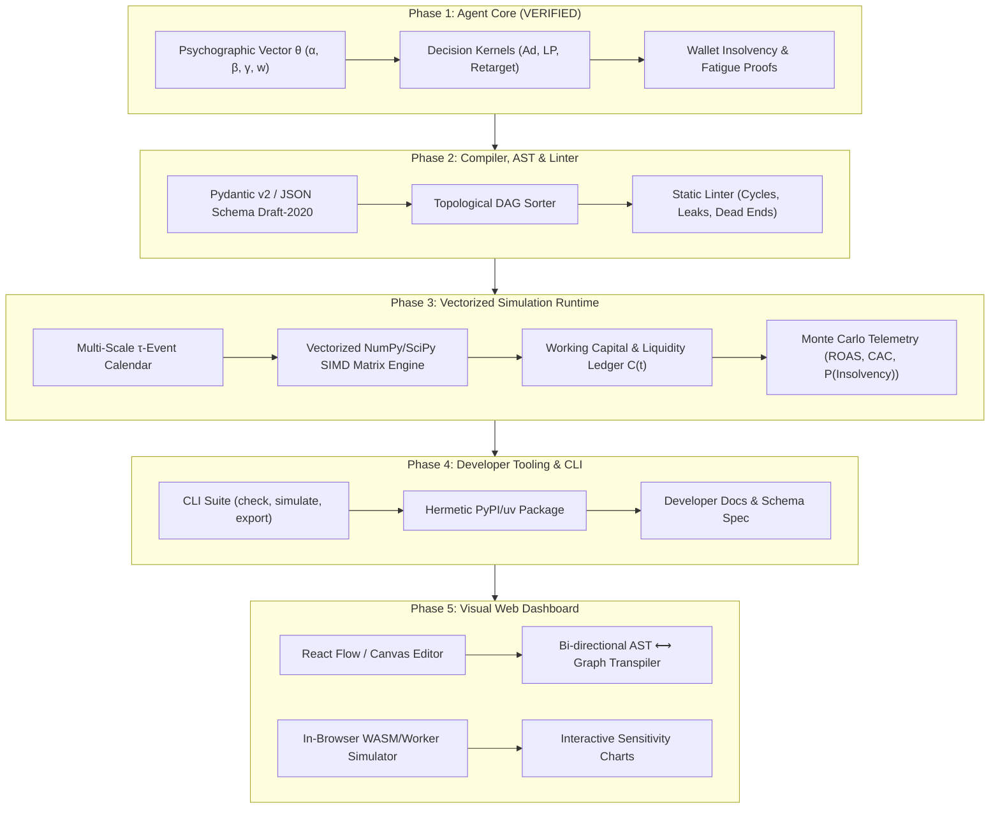

# FunnelScript Master Execution Plan (Phases 2 – 5)

**Governing Constitution:** [`AGENTS.md`](file:///Users/mamdouhaboammar/Documents/funnelscript/AGENTS.md) (Hypothesis-First & Research-Gated Engineering)  
**Methodology:** Core-Outwards & Discrete-Event Systems Engineering  
**Version:** 1.0.0 — Production Blueprint  

---

## Executive Summary & Baseline State

The FunnelScript ecosystem elevates marketing tactics from ambiguous slide decks into mathematically verifiable, executable discrete-event state machines. 

### Phase 1 Baseline (Complete & Verified):
* **Module:** `funnelscript.core.agent`
* **Artifacts:** Vectorized & discrete consumer agent representation ($\theta = \langle \alpha, \beta, \gamma, w \rangle$), stochastic micro-decision formulas ($P_{\text{click}}, P_{\text{purchase}}, P_{\text{recovery}}$), wallet insolvency boundary checks, ad fatigue decay models.
* **Verification:** 10/10 automated tests passing (`tests/test_agent_core.py`, `tests/test_funnelscript.py`), interactive 10-agent profiling sandbox (`examples/demo_agent_mind.py`).
* **Repositories:** Active, synced, and versioned at [`funnelscript/funnelscript`](https://github.com/funnelscript/funnelscript) and [`funnelscript/funnelscript-research`](https://github.com/funnelscript/funnelscript-research).

---

## The Master Architecture Flow

---

## Phase 2: The AST, JSON Schema & Static Semantic Linter

### 1. Scope & Objective
Formalize the campaign specification into an immutable, type-safe Abstract Syntax Tree (AST), complete the EBNF grammar compiler, and build a deterministic static linter that catches reachability defects, attribution cycles, and audience leaks before execution.

### 2. Research Anchor & Prior Art
* **Graph Theory & Compilers:** Aho, Lam, Sethi, Ullman (*Compilers: Principles, Techniques, & Tools*). Topological sorting (Kahn's algorithm) and Tarjan's strongly connected components (SCC) algorithm for cycle detection in directed flow networks.
* **Declarative Schemas:** JSON Schema Draft 2020-12 / IETF RFC 8259.

### 3. Falsifiable Hypotheses
* **$H_{2.1}$ (Cycle & Dead-End Elimination):** *A graph-theoretic linter running Tarjan's SCC algorithm on the FunnelScript execution DAG detects 100% of non-terminating attribution loops and unreferenced touchpoint sinks in $O(V + E)$ time prior to runtime.*
  * *Falsification Criteria:* Any validly linted campaign that enters an infinite execution loop or hits an undefined node during Phase 3 simulation refutes $H_{2.1}$.
* **$H_{2.2}$ (Economic Boundary Enforcement):** *Schema-level static type verification detects 100% of negative budget allocations, invalid probability ranges ($p \notin [0, 1]$), and undefined audience sources at parse-time.*

### 4. Mathematical & Structural Invariants
1. **DAG Reachability Invariant:** Every declared touchpoint $v \in V_{\text{touchpoints}}$ must be reachable from at least one initial audience node $s_0$:
   $$\forall v \in V, \ \exists \text{ path } p = (s_0, \dots, v)$$
2. **Terminal Absorption Invariant:** Every directed path in the logic graph must terminate in an absorbing state:
   $$\forall p = (v_1, \dots, v_k), \ v_k \in \{\text{CONVERTED}, \text{CHURNED}\}$$
3. **Budget Non-Negativity:**
   $$B_{\text{total}} > 0, \quad \text{CPC}_{\max} > 0, \quad C_0 > 0$$

### 5. Implementation Tasks
* `src/funnelscript/compiler/linter.py`:
  - Build DAG from `StrategyAST.logic_flow`.
  - Implement Kahn's / Tarjan's algorithm for circular dependency detection.
  - Detect dead-end paths (traffic sent to a landing page with no subsequent conversion or churn branch).
  - Detect orphaned audiences (audiences declared in `entities` but never referenced in `flow`).
* `src/funnelscript/compiler/schema.py`:
  - Automated JSONSchema generation (`funnelscript.json-schema`).
* `tests/test_linter.py`:
  - Test suite with 25 corrupted edge-case campaigns (cyclic retargeting, negative budgets, disconnected sinks).

### 6. Contrarian Stress Test (`hate` check)
* *Fatal Flaw:* What if a marketer intentionally wants a recurrent retargeting sequence (e.g. email 1, wait 2 days, email 2, wait 3 days, email 3)? A naive DAG linter would flag this as an "infinite cycle."
* *Mitigation:* Allow bounded recurrence by requiring a monotonic step counter (`max_retries: int <= 5`) on retargeting loops. If no exit condition or step decrement is present, the linter rejects it.

### 7. Definition of Done
* `funnelscript check <file>` successfully lints valid campaigns and rejects all 25 malformed edge cases with clean terminal error diagnostics.
* 100% test coverage on `compiler/linter.py`.

---

## Phase 3: The Vectorized Stochastic Runtime Engine

### 1. Scope & Objective
Scale the discrete agent mechanics from Phase 1 into a high-throughput, vectorized multi-scale event simulation engine capable of running $100,000$ agents across $M = 1,000$ Monte Carlo trials in seconds, calculating full distribution curves for ROAS, CAC, cash runway, and cannibalization.

### 2. Research Anchor & Prior Art
* **Discrete-Event Simulation (DES):** Law & Kelton (*Simulation Modeling and Analysis*); Zeigler (*Theory of Modeling and Simulation*).
* **Vectorized Probability:** SIMD array programming via NumPy 2.x and SciPy stochastic kernels.
* **Computational Economics:** Jay Forrester (*Industrial Dynamics* — MIT Stock & Flow differential equations).

### 3. Falsifiable Hypotheses
* **$H_{3.1}$ (Throughput Scaling):** *Vectorizing agent psychographic evaluations via 2D NumPy array broadcasting processes $\ge 500,000 \text{ agent-days/second}$ on standard commodity CPU hardware, completing $M = 1,000$ trials in $< 15 \text{ seconds}$.*
  * *Falsification Criteria:* Any benchmark runtime exceeding $20\text{ms}$ per 10,000 agent-days refutes $H_{3.1}$.
* **$H_{3.2}$ (Cash Ruin Separation):** *Simulating payment processor settlement delays ($\Delta_{\text{settle}} \in [2, 7]$ days) exposes an emergent Cash Ruin probability $P(\text{Insolvency}) > 0$ that linear expected-value models fail to predict.*

### 4. Mathematical & Structural Invariants
1. **Audience Mass Conservation:**
   $$\sum_{s \in S} N_s(t) = N_{\text{total}}, \quad \forall t \in [0, T]$$
2. **Working Capital Dynamics:**
   $$C(t) = C(t-1) - \text{Spend}(t) + \text{SettledRevenue}(t - \Delta_{\text{settle}})$$
   $$\text{If } C(t) \le 0 \implies \text{HaltAdSpend}(t)$$
3. **Adstock Temporal Decay:**
   $$A_j(t) = \text{Impression}_j(t) + \lambda \cdot A_j(t-1), \quad \lambda \in [0, 1)$$

### 5. Implementation Tasks
* `src/funnelscript/runtime/engine.py`:
  - Multi-scale timeline orchestrator ($t \in [1, T]$ days with sub-daily event resolution).
  - Vectorized audience state tensor: `shape = (N_agents, 4)` for psychographics, `state = (N_agents,)`.
  - Payout settlement delay queue (circular buffer for $t + \Delta_{\text{settle}}$).
* `src/funnelscript/runtime/telemetry.py`:
  - Monte Carlo distribution aggregator: Mean, Median, P10, P90, Value-at-Risk (VaR).
  - Discount cannibalization counter (loyal buyers with $\alpha > 0.75$ using retargeting vouchers).
* `src/funnelscript/runtime/exporters.py`:
  - Export simulation curves to CSV and JSON formats.
* `tests/test_simulation_scale.py`:
  - Performance benchmarks, conservation stress tests, and liquidity halts.

### 6. Contrarian Stress Test (`hate` check)
* *Fatal Flaw:* What if memory consumption blows up when running $10^5$ agents across $1,000$ trials ($10^8$ operations)?
* *Mitigation:* Never store full agent histories across Monte Carlo iterations. Collapse agent states into summary statistical aggregates at the end of each day; retain only scalar trial outcomes in memory.

### 7. Definition of Done
* Successful simulation of $100,000$ agents over 30 days across 1,000 trials in $< 15$ seconds.
* Output of complete probability distributions and liquidity risk metrics.

---

## Phase 4: Developer Tooling, Packaging & CLI Suite

### 1. Scope & Objective
Transform FunnelScript into an ergonomic, production-grade CLI tool and standalone Python package installable via `pip` or `uv tool`, accompanied by comprehensive developer documentation and schema definitions.

### 2. Research Anchor & Prior Art
* **Command-Line Interface Ergonomics:** POSIX IEEE 1003.1 conventions; Twelve-Factor App methodology for config and logs; Rich Terminal formatting standards.
* **Package Distribution:** PEP 517/518/621 build standards using `pyproject.toml` and Hatchling.

### 3. Falsifiable Hypotheses
* **$H_{4.1}$ (Hermetic Execution):** *The packaged FunnelScript CLI executes cleanly in a fresh isolated Python 3.12+ virtual environment with zero missing shared libraries and under $300\text{ms}$ cold startup time.*
* **$H_{4.2}$ (Deterministic Exit Codes):** *CLI commands map 1:1 with standard UNIX exit codes: `0` for verification/simulation pass, `1` for syntax/invariant error, `2` for file I/O failure.*

### 4. Implementation Tasks
* `src/funnelscript/cli.py`:
  - Enhance commands:
    * `funnelscript check <file>`: Strict static type check & lint.
    * `funnelscript simulate <file> [--trials N] [--agents N] [--export-csv path] [--json]`: Run simulation and display rich tables.
    * `funnelscript init <name>`: Generate starter campaign template.
    * `funnelscript schema`: Print or export JSON Schema.
* Packaging:
  - Configure `[project.scripts]` entrypoint: `funnelscript = "funnelscript.cli:main"`.
  - Validate clean wheel build via `uv build`.
* `docs/`:
  - `docs/CLI_REFERENCE.md`: Complete flags and usage manual.
  - `docs/SCHEMA_SPEC.md`: Full entity and block specification.
  - `docs/ANTI_PATTERNS.md`: Catalog of marketing anti-patterns detected by FunnelScript (e.g., The Discount Trap, The Liquidity Mirage, The Retargeting Loop).
* `tests/test_cli.py`: Subprocess execution tests for all CLI flags.

### 5. Definition of Done
* `uv run funnelscript --help` runs seamlessly.
* Successful local build and install test (`uv tool install . --force`).

---

## Phase 5: Visual Web Dashboard (Funnel Canvas & Live Simulation)

### 1. Scope & Objective
Build an interactive visual canvas for marketing practitioners that allows visual drag-and-drop funnel construction, bi-directional code generation (`Visual Graph ⟷ FunnelScript JSON`), and live in-browser Monte Carlo sensitivity analysis.

### 2. Research Anchor & Prior Art
* **Flow-Based Programming:** Morrison (*Flow-Based Programming: A New Approach to Application Development*).
* **Information Visualization:** Edward Tufte (*The Visual Display of Quantitative Information*); Shneiderman's Information Seeking Mantra (*Overview first, zoom and filter, then details-on-demand*).
* **Graph Editors:** React Flow / Svelte Flow component model.

### 3. Falsifiable Hypotheses
* **$H_{5.1}$ (Isomorphic Bi-directionality):** *Any valid visual canvas topology serialized to FunnelScript JSON compiles without error, and any valid FunnelScript JSON renders onto the canvas with zero node overlap or edge inversion ($100\%$ topological isomorphism).*
* **$H_{5.2}$ (Interactive Latency):** *Running local micro-simulations ($10,000$ agents, 14 days) on parameter adjustment (e.g. moving a CPC slider) completes in $< 350\text{ms}$, providing real-time interactive feedback without UI jank.*

### 4. Architectural Stack
* **Framework:** React 19 + TypeScript + Vite.
* **Canvas Engine:** React Flow (@xyflow/react) for draggable nodes (`AudienceNode`, `TrafficNode`, `ConversionNode`, `RetargetingNode`).
* **Styling & UI:** Tailwind CSS, Radix UI primitives, Lucide icons (anti-slop restraint: clean white space, zero marketing clutter).
* **Charting:** Recharts / Chart.js for ROAS probability curves, CAC density plots, and cumulative cash trajectories.
* **Engine Bridge:** Local Python backend API (FastAPI) or WebAssembly (Pyodide) compiling FunnelScript directly in the browser sandbox.

### 5. Implementation Tasks
* `apps/web/`:
  - `components/canvas/`: Custom nodes and edge connections with validation rules (e.g., preventing connecting two audiences directly).
  - `components/telemetry/`: Real-time ROAS distribution histogram, CAC curve, and Cash Runway chart.
  - `components/code-drawer/`: Real-time bi-directional code viewer showing generated FunnelScript JSON.
  - `lib/transpiler.ts`: Graph-to-JSON and JSON-to-Graph serialization engine.
* `tests/e2e/`: Playwright end-to-end tests verifying drag, drop, compile, and simulate workflows.

### 6. Definition of Done
* A user can construct an end-to-end campaign visually, see the generated FunnelScript JSON update live, click "Simulate", and inspect probability curves and cash ruin risk in under 1 second.

---

## Phase-by-Phase Timeline & Milestone Summary

| Phase | Milestone | Deliverable | Primary Metric |
| :--- | :--- | :--- | :--- |
| **Phase 1** | The Agent Core | `funnelscript.core.agent` | 100% test coverage; 10/10 green tests |
| **Phase 2** | Compiler & Linter | `funnelscript.compiler.linter` | Catch 100% of cyclic & dead-end defects |
| **Phase 3** | Vectorized Runtime | `funnelscript.runtime.engine` | $\ge 500\text{k}$ agent-days/sec; P(Insolvency) telemetry |
| **Phase 4** | Developer Tooling | `funnelscript` CLI & PyPI package | Hermetic wheel build; exit-code parity |
| **Phase 5** | Visual Web Dashboard | `apps/web` (React Flow + Charts) | $100\%$ isomorphic serialization; $<350\text{ms}$ sim |

---

## Constitutional Compliance Verification

Every step in this plan complies strictly with [`AGENTS.md`](file:///Users/mamdouhaboammar/Documents/funnelscript/AGENTS.md):
- **Rule 1 Enforced:** Every phase specifies its research anchor, falsifiable hypothesis ($H$), and mathematical invariant.
- **Inside-Out Discipline:** Physical UI is strictly fenced into Phase 5, after the mathematical core (P1), linter (P2), runtime (P3), and CLI (P4) are fully verified.
- **Conservation Laws Preserved:** Cash latency ($\Delta_{\text{settle}}$), mass conservation ($\sum N = N_{\text{total}}$), and wallet bounds ($P_{\text{eff}} \le w$) are enforced throughout.

---

## Active Language-Core Milestone: Domain-Neutral Event Semantics (2026-10-31)

**Research gate:** `funnelscript-research/spec/event-kernel-v0.md` documents Zeigler/DEVS, Koka-style handler separation, falsifiable hypotheses H-K1 through H-K4, and the formal event-order/temporal invariants.

**Implementation:** `src/funnelscript/core/event_machine.py` adds a bounded, seeded event calendar, model-owned state transitions, and inert `EffectIntent` values. It intentionally has no audience, campaign, platform, or credential knowledge. Public symbols are exposed through `funnelscript.core`. Existing marketing simulation and compiler behavior are preserved.

**Verification:** `tests/test_event_machine.py` covers event order, stable ties, same-time scheduling, deterministic replay, invalid timestamps, retrograde events, priority inversion, processing bounds, finite horizons, domain neutrality, and unexecuted intents. A passing test suite verifies local semantics only; it does not validate future market predictions.

**Next integration gates (not yet implemented):**
1. Define a neutral `Entity` / `Agent` source-language and AST typing contract, retaining compatibility with the legacy consumer `Agent`.
2. Move `Audience`, `Campaign`, `Touchpoint`, and economic invariants into first-party marketing library surfaces with no compiler-only privilege.
3. Build controlled Simulation and Shadow effect handlers and explicit capabilities; Live execution remains blocked until provider authorization, idempotency persistence, monetary limits, and adversarial security gates are independently tested.
4. Provide optional, versioned empirical calibration adapters for PyMC Marketing and cognitive model adapters for OmniTwin without hard dependencies.

---

## Language Core Milestone: Typed World Declarations (2026-10-31)

**Research gate:** `funnelscript-research/spec/world-declarations-v0.md` records H-W1 through H-W4, prior art on type systems, and explicit uniqueness and literal-typing invariants. The grammar is added as a new `ProgramFile` alternative in `spec/grammar.ebnf`.

**Implementation:** Contextual `world`/`entity`/`agent`/`state` declarations now parse into `WorldAST`, `EntityDefinition`, `AgentDefinition`, and `StateDefinition`. Primitive `int`, `float`, `bool`, `string` initializers are type checked without coercion. Both the CLI `check` branch and an explicit world-simulation rejection path are implemented. The old strategy parser and marketing simulator remain available.

**Verification:** `tests/test_world_language.py` exercises valid AST/subtyping, duplicate and unknown declarations, mismatched literals, malformed syntax, legacy keyword compatibility, CLI typing and simulation rejection. Smoke input: `examples/warehouse_world.fnl`.

**Next gates:** Typed `rule` and `transition` declarations, source-language runtime construction and dispatch to the already tested EventMachine; no autonomous behavior, real-market calibration, or live execution is claimed from typed state declarations alone.

---

## Language Core Milestone: Executable Rules and Transitions (2026-10-31)

**Research gate:** `funnelscript-research/spec/rule-transitions-v0.md` defines H-R1 through H-R4, explicit simultaneous-update semantics, uniqueness/type invariants, and restricted expressions. The formal `spec/grammar.ebnf` now includes `RuleDeclaration` and `TransitionStatement`.

**Implementation:** Typed `EventRuleDefinition`, `StateTransitionDefinition` and expression nodes extend the World AST; the parser accepts contextual `rule R on event E { transition ...; }` blocks. `WorldExecutor` dispatches externally supplied qualified events through the existing `EventMachine`, using copy-on-write and one pre-event snapshot per rule. `run-world` emits a pure JSON state summary. No dynamic `eval`, autonomous event generation, provider interaction or new scheduler is introduced.

**Verification:** Focused TDD `tests/test_world_rules.py` (21 passing tests), complete Python suite (85 passing tests as checked on 2026-10-31), and a CLI smoke example at `examples/counter_world.fnl`. Results verify the interpreter and legacy compatibility, not empirical predictive performance.

**Next gates:** Property-based transition tests, source-level event emission and effects with capability checks, stochastic primitive/agent models, module and standard-library boundaries, PyMC Marketing/OmniTwin calibration adapters, and separately controlled Simulation/Shadow/Live handlers. Preserve language neutrality throughout.
